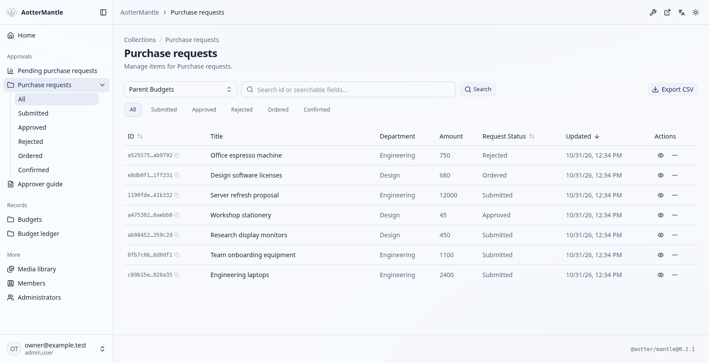
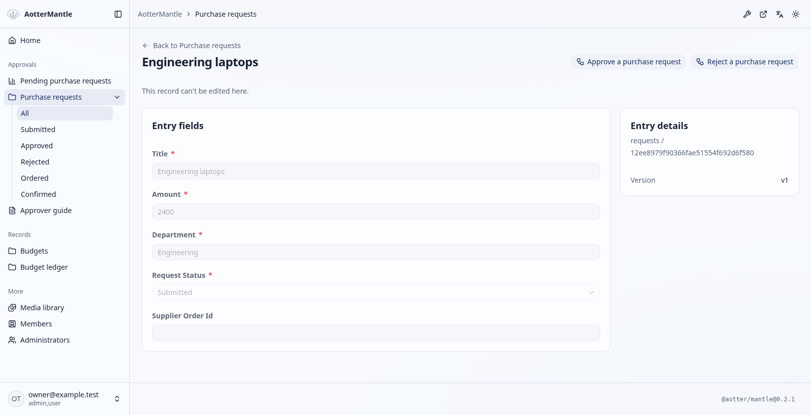
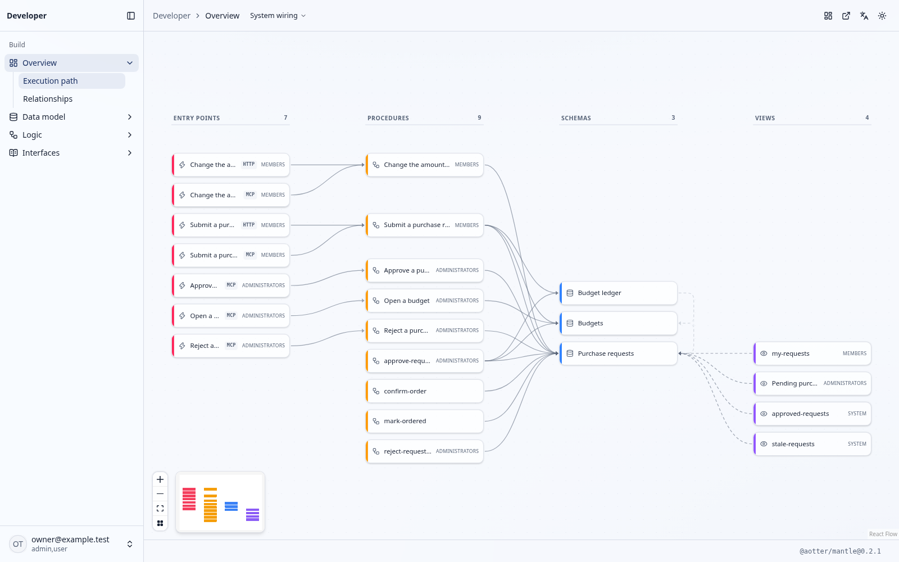
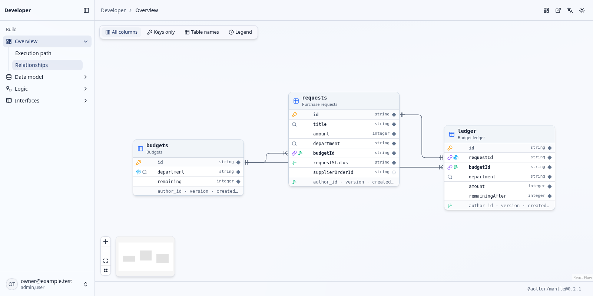
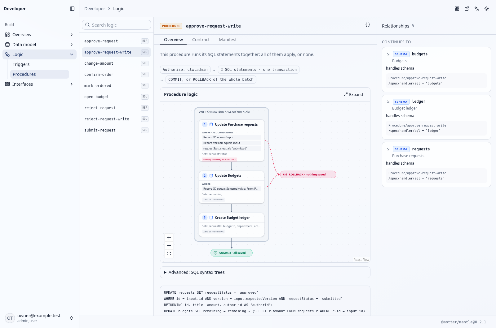

<h1 align="center">Mantle</h1>

<p align="center">
  <strong>Build custom applications from models and business operations.</strong>
</p>

<p align="center">
  <a href="https://github.com/aotter/mantle/actions/workflows/ci.yml"></a>
  <a href="https://github.com/aotter/mantle/stargazers"></a>
  <a href="https://www.npmjs.com/package/@aotter/mantle"></a>
  <a href="https://github.com/aotter/mantle/releases"></a>
  <a href="https://nodejs.org/"></a>
  <a href="LICENSE"></a>
</p>

<p align="center">
  <a href="#get-started">Get started</a> &middot;
  <a href="#see-what-you-build">Product tour</a> &middot;
  <a href="#four-atoms-connected-interfaces">How it works</a> &middot;
  <a href="docs/examples/README.md">Examples</a> &middot;
  <a href="#documentation">Documentation</a>
</p>

<p align="center">
  
  <br>
  <em>Be the dungeon master. Don’t code every corridor.</em>
</p>

Mantle is an SDK for building data-driven applications. Declare **Schemas,
Views, Procedures, and Triggers** in YAML; compile them into native SQL and
typed TypeScript for Cloudflare Workers or Bun. Add an Admin console, REST,
MCP, or public pages around the same models and operations, with authorization
and row rules enforced server-side.

Your app owns its routes, frontend, auth configuration, database handles, and
migrations.

## Get started

### Build with an agent

Install the Mantle skill in your coding agent:

```sh
npx skills add aotter/mantle@mantle
```

Describe what you want to build:

> Use Mantle to build a purchasing app with employee requests, admin approvals, and budget checks.

The skill guides planning, implementation, acceptance, and performance checks
using `mantle help` from your app’s installed version.
See [agent setup](docs/handbook/guides/agent-setup.md) for supported editors and plugins.

### Start an application yourself

Use Node.js **22.22+** and pnpm **9+**, and pin the SDK version:

```sh
npx @aotter/mantle@0.2.1 init my-app
cd my-app
pnpm install
pnpm exec mantle help
```

The shell includes an Admin console at `/admin`, REST, MCP at `/mcp`,
Admin MCP at `/mcp/admin`, email-code sign-in, `admin` and `user` roles,
and local acceptance tooling. Its `README.md` covers manifests, bindings,
local auth, initializing an empty database, and startup. `init` writes app-owned code once;
cloud resources and deployment remain yours.

[Follow the Worker quickstart →](docs/handbook/start/quickstart-worker.md)

**Adding Mantle to an existing app?** Keep your entry point and database;
[generate only the operations you need](docs/handbook/guides/typed-queries.md#adopt-mantle-in-an-existing-application).
Using ChatGPT Sites? Read [Mantle on ChatGPT Sites](docs/handbook/cloudflare/chatgpt-sites.md).

## See what you build

In the **Purchasing** workflow, employees submit requests and administrators
approve or reject them. Approval spends the budget and records the decision
atomically. The same operations serve application interfaces, Admin actions,
and MCP tools.

### An Admin workspace shaped by your model

The Approvals workspace groups requests and the pending queue. Declared
approval and rejection actions control transitions; generic editing is disabled.



<details>
<summary>Review a purchase request</summary>



Approval uses the version the administrator reviewed. A changed request or
invalid state is a conflict; exceeding the budget rolls back the decision,
deduction, and ledger write. Supplier orders happen only after commit.

</details>

### Follow the system wiring

At `/admin/dev`, trace Triggers through Procedures to their Schemas and Views,
and inspect HTTP, MCP, and WebMCP interfaces. SQL operations show their writes;
ref-handler internals stay in application code.



### Explore the data model

Each budget has many purchase requests and ledger entries. Each approved
request has at most one ledger entry. The ER diagram shows these declared
references, fields, keys, and indexes.



### Inspect the operation behind the button

In **approve-request-write**, the request update, budget deduction, and ledger
insert commit together. Stale versions, invalid transitions, or failed budget
checks roll back all three.



[Screenshot sources and reproduction](docs/assets/readme/README.md).

## Four atoms, connected interfaces

| Atom | Declare | Connects to |
|---|---|---|
| **Schema** | Fields, references, indexes, lifecycle, row scope, and locks | Database storage, typed Store, Admin records, and the relationship diagram |
| **View** | A SQL read with inputs, authorization, and a selected surface | Typed queries; selected REST, MCP, or Admin reads |
| **Procedure** | A business action using SQL or an application handler | Typed writes, validation, and declared Admin actions |
| **Trigger** | An HTTP or MCP entry point for a Procedure | An authorized, validated call to the same operation |

Operation authorization applies across Admin, REST, and MCP. Generated queries
and caller-bound Store writes enforce row rules.
[Explore the four atoms](docs/handbook/concepts/four-atoms.md).

### From model to working application

- **Give your team a working Admin.** Collections, related records, publishing,
  reports, and business actions follow the model. Customize navigation, pages,
  fields, and record regions with application-owned React.
  [Admin guide](docs/handbook/guides/native-admin.md).
- **Keep business guarantees close to the data.** SQL Procedures commit their
  statements atomically; explicit version checks reject stale writes. Schema
  locks protect sealed content, including from admin callers.
  [Procedures](docs/handbook/concepts/procedures-and-triggers.md).
- **Connect agents through MCP and Admin MCP.** Expose domain tools and
  privileged operations from the same model. Remote clients authenticate to
  the app; Admin's WebMCP tools use the signed-in browser session.
  [MCP and WebMCP](docs/handbook/concepts/mcp-and-agents.md).
- **Publish pages from the same content.** Add public Views and the optional
  `web()` module for `llms.txt`, sitemaps, Markdown alternates, and canonical head
  tags. Your app renders its HTML.
  [Public pages](docs/handbook/guides/public-pages.md).

## A small manifest, a working queue

This View supplies the pending queue in Admin and is also available through
Admin MCP:

```yaml
apiVersion: cms.mantle.aotter.net/v2
kind: View
metadata: { name: pending-requests }
spec:
  title: Pending purchase requests
  surface: admin
  requires: { auth: { all: [ctx.admin] } }
  sql: |
    SELECT id, title, amount, department, version
    FROM requests WHERE requestStatus = 'submitted'
    ORDER BY created_at, id
```

Generate native SQL and TypeScript from your manifests:

```sh
pnpm exec mantle generate cloudflare-d1 generated manifests/*.yaml --admin
```

Pass your database handle and verified caller to the generated operations.
Mount the interfaces your app selects. `generate` writes `generated/` and
selected Wrangler build settings.
[Project layout and CLI](docs/handbook/start/project-and-cli.md).

## Targets, databases and packages

| Start with | Add when you need |
|---|---|
| [`@aotter/mantle`](packages/mantle/README.md) | Native generated queries, typed Store, compiler and the `mantle` CLI. |
| Target `cloudflare-d1` or `cloudflare-postgres` | App-owned Worker routing and D1 or postgres.js/Hyperdrive handles. |
| Target `bun-sqlite` or `bun-postgres` | App-owned Bun server using bun:sqlite or Bun.SQL. |
| `@aotter/mantle/auth` | Sign-in, admin roles, and OAuth for MCP. |
| [Service composition](docs/handbook/cloudflare/service-entry.md) | Mount selected interfaces inside your application. |

Manifest SQL uses PostgreSQL syntax and compiles for the selected target.
PostgreSQL uses Bun.SQL on Bun and postgres.js on Workers; other native handles
need an application-owned adapter. Upgrading from 0.1.x:
[the upgrade guide](docs/handbook/releases/upgrade-0.1-to-0.2.md); an existing PostgreSQL
service also reads [the release notes](docs/handbook/releases/index.md).

<details>
<summary>Package reference</summary>

| Package | Purpose |
|---|---|
| `@aotter/mantle` | Native SDK, private compiler, generator and CLI; selected driver, auth, REST, MCP, web and site/media primitives. |
| `@aotter/mantle-ui` | Pure UI: generic interaction controller, React components, visual kit and design tokens. No SDK dependency. |
| `@aotter/mantle-admin` | Admin app library and thin server, preview and Admin MCP App. Uses UI and public SDK contracts; the SDK remains a peer. |

</details>

## FAQ

### What is Mantle?

An SDK for data-driven applications. Declare models and business operations;
compile them into typed SQL queries, and connect Admin, APIs, agent tools,
or public pages as needed.

### Is Mantle a framework?

No. Your app owns its entry point, routing, and auth. It calls generated
operations with its database handle and verified caller, and mounts selected
interfaces. `init` writes a starting shell once; `generate` maintains generated
files and Wrangler build settings.

### How is Mantle different from an ORM or a headless CMS?

You declare SQL reads and business actions in manifests. Mantle compiles them
with row policy, single-row write checks, and atomic Procedures. Publishing,
Admin, and public pages use the same model inside your app and database.

### Which databases and hosts does Mantle support?

Four targets: `cloudflare-d1` for D1, `cloudflare-postgres` for PostgreSQL via
postgres.js (usually with Hyperdrive), `bun-sqlite` for bun:sqlite, and
`bun-postgres` for Bun.SQL. Manifest SQL compiles for the selected dialect.

### How do AI agents use Mantle?

Coding agents use the skill, `mantle help`, and compiler diagnostics. Runtime
agents call declared tools at `/mcp` or `/mcp/admin`, with authorization, row
policy, and input checks enforced on each call. `/mcp` exposes public MCP
Triggers; `/mcp/admin` exposes admin tools to admin roles. See
[MCP and agents](docs/handbook/concepts/mcp-and-agents.md).

### Can Mantle serve `llms.txt`, a sitemap and Markdown pages?

Yes. The optional `web()` module uses public Views for these outputs and
canonical head tags. Unpublished drafts stay hidden; your app renders the HTML.
For JSON-LD and languages, see
[Public pages: SEO, AEO and languages](docs/handbook/guides/public-pages.md).

### Does Mantle run migrations?

No. Apply the generated `schema.sql` to an empty database for the first
install. After that, migrations belong to the application and its native tool.

## Documentation

- [Handbook](docs/handbook/start/overview.md) — concepts, setup, and task guides.
- [Build with an agent](docs/handbook/start/agents.md) — `mantle init`, `mantle help` and role-only acceptance.
- [Public pages: SEO, AEO and languages](docs/handbook/guides/public-pages.md) — `llms.txt`, sitemap, Markdown alternates, JSON-LD and hreflang.
- [Manifest feature reference](docs/handbook/reference/features.md) — capabilities and their authoring fields.
- [SDK and package API](packages/mantle/README.md) — installation, typed bindings, and optional modules.
- [Examples](docs/examples/README.md) — whole services, and the runnable reference service.
- [Upgrading from 0.1.x](docs/handbook/releases/upgrade-0.1-to-0.2.md) — for a coding agent doing the move.
- [Releases](https://github.com/aotter/mantle/releases) — changes and upgrade notes.

## Contributing

See [Contributing](CONTRIBUTING.md) for development and review,
[Support](SUPPORT.md) for questions and bugs, and [Security](SECURITY.md) for
private vulnerability reports. Contributors follow the
[Code of Conduct](CODE_OF_CONDUCT.md).

Apache 2.0. See [LICENSE](LICENSE).
