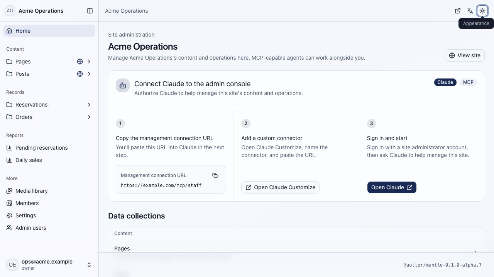
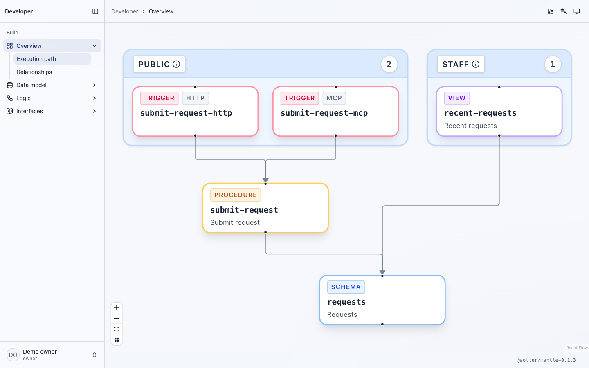

<h1 align="center">Mantle</h1>

<p align="center">
  <em>Be the dungeon master. Don’t code every corridor.</em>
</p>

<p align="center">
  
</p>

<p align="center">
  <strong>Schema. View. Procedure. Trigger. Four atoms from which your world takes shape.</strong><br>
  Speak it in plain YAML, and the dungeon wakes—whole, lit from within, and yours to command.
</p>

<p align="center">
  <a href="https://github.com/aotter/mantle/actions/workflows/ci.yml"></a>
  <a href="https://github.com/aotter/mantle/stargazers"></a>
  <a href="https://www.npmjs.com/package/@aotter/mantle"></a>
  <a href="https://github.com/aotter/mantle/releases"></a>
  <a href="https://nodejs.org/"></a>
  <a href="LICENSE"></a>
</p>

<p align="center">
  <a href="#features">Features</a> &middot;
  <a href="#admin-for-people-and-agents">Admin</a> &middot;
  <a href="#get-started">Get started</a> &middot;
  <a href="#documentation">Documentation</a> &middot;
  <a href="docs/examples/README.md">Examples</a>
</p>

Mantle is an embeddable application engine for TypeScript. Define your data,
queries, actions, and triggers in a Manifest, then use them through typed APIs,
HTTP endpoints, agent tools, and a admin console when your app needs one.

Build a publishing site, an internal operations app, or an API for agents.
Your application owns its host, storage, and business logic; choose the Mantle
modules you need.

## Features

- **One Manifest, connected interfaces.** Schema, View, Procedure, and Trigger
  describe your data and behavior. The compiled definitions power typed APIs,
  HTTP routes, MCP tools, and Admin. [Manifest features](docs/handbook/reference/features.md).
- **Typed queries and actions.** Generate TypeScript bindings for entries,
  declarative Views, and Procedures. Keep host-only reads private with internal
  Views. [Typed queries](docs/handbook/guides/typed-queries.md).
- **Admin that follows your model.** Manage live records, publish content, run
  reports, and invoke business actions. Configure columns, filters, and actions
  with Manifest `uiSchema`. [Admin customization](docs/handbook/guides/admin-ui.md).
- **Tools for browser and remote agents.** Admin supports WebMCP using the
  signed-in admin session. Remote MCP clients connect through authenticated
  endpoints, with authorization checked on each call.
  [MCP and WebMCP](docs/handbook/concepts/mcp-and-agents.md).
- **Publishing.** Draft/publish workflows, localized content and full-text
  search, served over REST and MCP.
  [Generated website example](docs/examples/generated-web/README.md).
- **Embed in an existing application.** Mount the REST, MCP or Admin surface
  you need inside your own Worker or server entry.
  [Integration choices](#choose-how-much-to-use).

## Admin for people and agents

Give admin a workspace for content, operational records, reports, and actions.
In browsers supporting WebMCP, agents can discover and invoke admin tools from
Admin, inspect the current page, and navigate alongside the user. Calls use the
current admin session and retain server-side authorization and concurrency checks.



### Developer UI and application API docs

Explore your application's Schemas, Views, Procedures, Triggers, and their
relationships in the admin-only Developer UI. Its HTTP, MCP, and WebMCP docs
show the application's projected routes and tool schemas, with links back to
the owning definitions.



*Developer UI rendered locally from the intake example. The graph describes
compiled declarations; it does not certify runtime or deployment health.*

The application serves the console at `/admin` from the Admin that `mantle bundle`
builds into `dist/client/admin`; this view draws from the admin-only
`GET /admin/api/developer-console`.

| Interface | Integration guide |
|---|---|
| HTTP | [Writes: Procedures and Triggers](docs/handbook/concepts/procedures-and-triggers.md) |
| Remote MCP | [Endpoints, tools, and authentication](docs/handbook/concepts/mcp-and-agents.md) |
| Browser WebMCP | [WebMCP in Admin](docs/handbook/concepts/mcp-and-agents.md) |

## A Manifest in practice

An intake application needs request records, a submission action, and a admin
inbox. Its admin View can be as small as:

```yaml
apiVersion: cms.mantle.aotter.net/v2
kind: View
metadata: { name: recent-requests }
spec:
  title: Recent requests
  surface: admin
  sql: |
    SELECT id, name, email, message, created_at FROM requests
    ORDER BY created_at DESC LIMIT 50
```

Together with the `requests` Schema, this defines the read used by the admin
report and its MCP tool. A Procedure handles submissions, with Triggers choosing
HTTP and MCP exposure.

For a complete runnable application, see the
[reference service](docs/examples/reference-service/README.md).

## Get started

### With a coding agent

Install the Mantle skill to get guided setup for your application and the
features you need:

```sh
npx skills add https://github.com/aotter/mantle/tree/v0.2.0-alpha.7 --skill mantle
```

Ask your agent to follow the installed skill and describe what you want to build.
Use the release tag matching your application's SDK; an unqualified repository
install follows `main`, which can lag an alpha release on `develop`.
See the [agent setup guide](docs/handbook/guides/agent-setup.md) for supported
editors, plugins, and project instructions.

### Build it yourself

Use Node 22.22+ and install an exact 0.2.x version of `@aotter/mantle`, with
matching Admin/UI packages when selected. Write your manifests, then run
`mantle generate <target> <output-directory> <manifest>...`, for example
`mantle generate cloudflare-d1 generated manifests/*.yaml`.
The generator writes native TypeScript/SQL and Workers split-build settings;
your application supplies its entry, routes, auth and database handles.
Follow the
[quickstart](docs/handbook/start/quickstart-worker.md), then the
[project and CLI guide](docs/handbook/start/project-and-cli.md). The
[reference service](docs/examples/reference-service/README.md) is a whole
service with its smoke test.

Using ChatGPT Sites? Follow [Mantle on ChatGPT Sites](docs/handbook/cloudflare/chatgpt-sites.md).

## Choose how much to use

| Start with | Add when you need |
|---|---|
| [`@aotter/mantle`](packages/mantle/README.md) | Native generated queries, typed Store, compiler and the `mantle` CLI. |
| Target `cloudflare-d1` or `cloudflare-postgres` | App-owned Worker routing and D1 or postgres.js/Hyperdrive handles. |
| Target `bun-sqlite` or `bun-postgres` | App-owned Bun server using bun:sqlite or Bun.SQL. |
| `@aotter/mantle/auth` | Sign-in, admin roles, and OAuth for MCP. |
| [The reference service](docs/examples/reference-service/README.md) | A whole service to read and run. |

PostgreSQL and SQLite are the two built-in dialects. Manifest SQL uses the
compiler's PostgreSQL syntax and is rendered for the selected target.
PostgreSQL uses Bun.SQL on Bun and postgres.js on Workers; other native handles
need an application-owned adapter. Upgrading from 0.1.x:
[the upgrade guide](docs/upgrade-0.1-to-0.2.md); an existing PostgreSQL
service also reads [the release notes](docs/handbook/releases/index.md).

<details>
<summary>Package reference</summary>

| Package | Purpose |
|---|---|
| `@aotter/mantle` | Native SDK, private compiler, generator and CLI; selected driver, auth, REST, MCP, web and site/media primitives. |
| `@aotter/mantle-ui` | Pure UI: generic interaction controller, React components, visual kit and design tokens. No SDK dependency. |
| `@aotter/mantle-admin` | Admin SPA and thin server, extensions, preview and Admin MCP App. Uses UI and public SDK contracts; the SDK remains a peer. |

</details>

## Documentation

- [Handbook](docs/handbook/start/overview.md) — concepts, setup, and task guides.
- [Manifest feature reference](docs/handbook/reference/features.md) — capabilities and their authoring fields.
- [SDK and package API](packages/mantle/README.md) — installation, typed bindings, and optional modules.
- [Examples](docs/examples/README.md) — whole services, and the runnable reference service.
- [Upgrading from 0.1.x](docs/upgrade-0.1-to-0.2.md) — for a coding agent doing the move.
- [Releases](https://github.com/aotter/mantle/releases) — changes and upgrade notes.

## Contributing

See [Contributing](CONTRIBUTING.md) for development and review,
[Support](SUPPORT.md) for questions and bugs, and [Security](SECURITY.md) for
private vulnerability reports. Contributors follow the
[Code of Conduct](CODE_OF_CONDUCT.md).

Apache 2.0. See [LICENSE](LICENSE).
