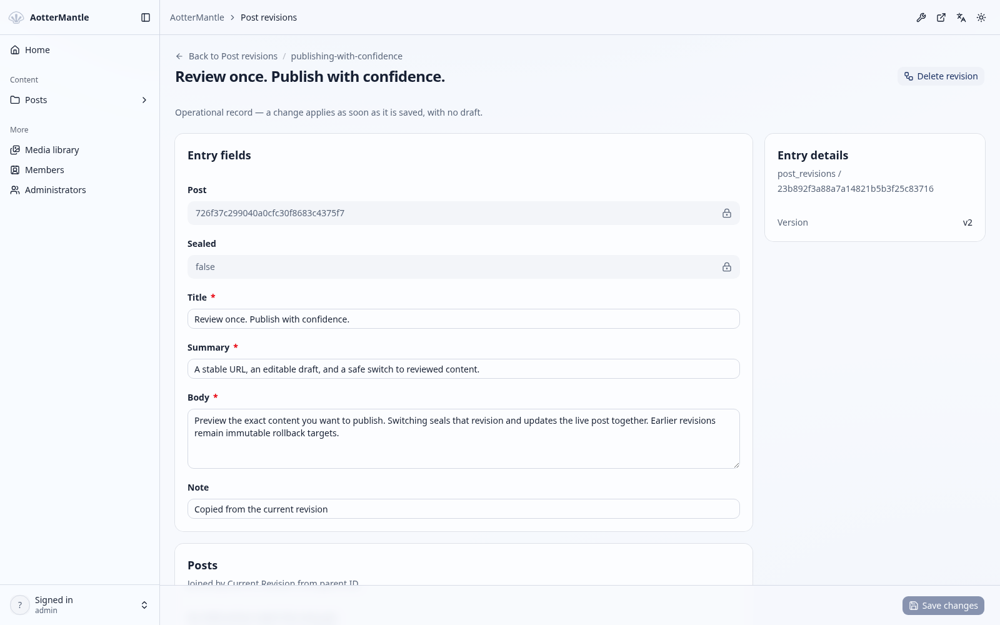

<h1 align="center">Mantle</h1>

<p align="center">
  <strong>Model your app in YAML. Get typed SQL, an Admin workspace, and tools for your AI.</strong>
</p>

<p align="center">
  <a href="https://github.com/aotter/mantle/actions/workflows/ci.yml"></a>
  <a href="https://github.com/aotter/mantle/stargazers"></a>
  <a href="https://www.npmjs.com/package/@aotter/mantle"></a>
  <a href="https://github.com/aotter/mantle/releases"></a>
  <a href="https://nodejs.org/"></a>
  <a href="LICENSE"></a>
</p>

<p align="center">
  <a href="#get-started">Get started</a> &middot;
  <a href="#see-what-you-build">Product tour</a> &middot;
  <a href="#four-atoms-connected-interfaces">How it works</a> &middot;
  <a href="docs/examples/README.md">Examples</a> &middot;
  <a href="#documentation">Documentation</a>
</p>

Mantle is an open-source application SDK for developers and AI coding agents.
Declare **Schemas, Views, Procedures, and Triggers** in YAML; compile them into
native SQL and typed TypeScript for Cloudflare Workers or Bun. Select the REST,
MCP, Admin, auth, and publishing capabilities your app needs.

Your application owns its routes, frontend, authentication configuration,
database handles, and migrations. Mantle connects the declared model to the
interfaces you choose, with authorization and row rules enforced on the server.

## Get started

### Build with an agent

Install the Mantle skill in your coding agent:

```sh
npx skills add aotter/mantle@mantle
```

Then describe the product you want. For example:

> Use the Mantle skill to build an editorial workspace with posts and revisions.
> Keep the published article online while an editor prepares the next version.
> Include an Admin workspace, a preview, and an explicit switch to reviewed content.

The skill guides the agent through planning, implementation, checks, role-based
acceptance, and performance measurement. It reads `mantle help` from the version
installed in your app, so the API guidance matches the package you are using.
See [agent setup](docs/handbook/guides/agent-setup.md) for supported editors and plugins.

### Start an application yourself

Use Node.js **22.22+** and pnpm **9+**. Scaffold the app shell with an exact SDK version:

```sh
npx @aotter/mantle@0.2.1 init my-app
cd my-app
pnpm install
pnpm exec mantle help
```

The shell includes email-code sign-in, `admin` and `user` roles, Admin, REST,
MCP, and local acceptance tooling. Follow its generated `README.md` to add your
business manifests, generate the bindings, configure local auth, initialize an
empty database, and start the app. `init` writes the shell once; it does not
provision cloud resources or deploy it.

[Follow the Worker quickstart →](docs/handbook/start/quickstart-worker.md) ·
[Browse complete examples →](docs/examples/README.md)

**Adding Mantle to an existing app?** Keep your entry point and database;
[generate only the operations you need](docs/handbook/guides/typed-queries.md#adopt-mantle-in-an-existing-application).
Using ChatGPT Sites? Read [Mantle on ChatGPT Sites](docs/handbook/cloudflare/chatgpt-sites.md).

## See what you build

The following screenshots show a running, English-language application built
from the official [posts and revisions recipe](docs/handbook/guides/revisions.md).
One example connects the editing workflow, data relationships, entry points,
and business operations.

### An Admin workspace shaped by your model

A post keeps its URL and publishing status. Its revisions hold the content.
Admin groups revisions under their post and exposes the declared **New revision**
and **Switch revision** operations. A sealed revision remains readable, while
its edit and delete controls are disabled by the server-enforced lock.


<details>
<summary>Open the revision editor</summary>



The recipe adds a custom Admin page to preview a revision and switch to the
exact version reviewed. New edits leave the live page unchanged until the
switch commits. Previously selected revisions stay immutable and can be
selected again for rollback. The initial publication is a separate **Publish**
action on the post.

</details>

### Follow the system wiring

The Developer UI shows how Triggers invoke Procedures, which Schemas those
Procedures write, and which Views read them. Inspect the connected declarations
and the application's HTTP, MCP, and WebMCP interface documentation at `/admin/dev`.


### Explore the data relationships

The entity relationship diagram exposes fields, keys, indexes, and declared
references. Here, each revision belongs to a post, and the post points to its
currently selected revision. References describe the model; the application
still enforces relationship eligibility in its writes.


### Inspect the operation behind the button

The procedure chart renders the declared SQL logic. **New revision** copies the
current content, or starts an empty first revision; the chart shows the branch,
the write, and its commit boundary beside the source SQL and related declarations.
The separate **Switch revision** ref handler uses a caller-bound Store batch to
seal the reviewed candidate and update the post pointer together.


These are real Admin screenshots, not mockups. Diagrams inspect compiled
manifest declarations; they do not certify runtime or deployment health.
[Capture details and reproduction commands](docs/assets/readme/README.md).

## Four atoms, connected interfaces

| Atom | Declare | Connects to |
|---|---|---|
| **Schema** | Fields, references, indexes, lifecycle, row scope, and locks | Database storage, typed Store, Admin records, and the relationship diagram |
| **View** | A SQL read with inputs, authorization, and a selected surface | Typed queries; selected REST, MCP, or Admin reads |
| **Procedure** | A business action using SQL or an application handler | Typed writes, validation, and declared Admin actions |
| **Trigger** | An HTTP or MCP entry point for a Procedure | An authorized, validated call to the same operation |

Choose what each role can invoke and which rows it can access. An Admin button,
a REST request, and an MCP call use the declared operation's authorization;
row policy remains enforced in generated queries and caller-bound Store writes.
[Explore the four atoms](docs/handbook/concepts/four-atoms.md).

### Built for people and agents

- **Give editors a working Admin.** Collections, related records, publishing,
  reports, and business actions follow the model. Customize navigation, pages,
  fields, and record regions with application-owned React.
  [Admin guide](docs/handbook/guides/native-admin.md).
- **Let AI clients do the same work.** Selected MCP tools expose your declared
  reads and actions. Admin's WebMCP tools use the signed-in browser session;
  remote MCP clients authenticate to the app's endpoints. Authorization is
  checked on each call. [MCP and WebMCP](docs/handbook/concepts/mcp-and-agents.md).
- **Keep business guarantees close to the data.** SQL Procedures commit their
  statements atomically; explicit version checks reject stale writes. Schema
  locks protect sealed content, including from admin callers.
  [Procedures](docs/handbook/concepts/procedures-and-triggers.md) ·
  [Revision workflow](docs/handbook/guides/revisions.md).
- **Publish pages from the same content.** Add public Views and the optional
  `web()` module for `llms.txt`, sitemaps, Markdown alternates, and canonical head
  tags. Your app renders its HTML.
  [Public pages](docs/handbook/guides/public-pages.md).

## A small manifest, a real query

A View declares the read an application needs. With its `requests` Schema,
this example supplies an Admin report and its admin MCP read tool:

```yaml
apiVersion: cms.mantle.aotter.net/v2
kind: View
metadata: { name: recent-requests }
spec:
  title: Recent requests
  surface: admin
  requires: { auth: { all: [ctx.admin] } }
  sql: |
    SELECT id, name, email, message, created_at FROM requests
    ORDER BY created_at DESC, id DESC LIMIT 50
```

Generate native SQL and TypeScript from your manifests:

```sh
pnpm exec mantle generate cloudflare-d1 generated manifests/*.yaml --admin
```

The app passes its native database handle and verified caller to generated
operations, and mounts the selected interfaces. `generate` writes `generated/`
and selected Wrangler build settings. Read the
[project and CLI guide](docs/handbook/start/project-and-cli.md) for the outputs,
checks, and application-owned files. The
[reference service](docs/examples/reference-service/README.md) shows a complete
service and its smoke test.

## Targets, databases and packages

| Start with | Add when you need |
|---|---|
| [`@aotter/mantle`](packages/mantle/README.md) | Native generated queries, typed Store, compiler and the `mantle` CLI. |
| Target `cloudflare-d1` or `cloudflare-postgres` | App-owned Worker routing and D1 or postgres.js/Hyperdrive handles. |
| Target `bun-sqlite` or `bun-postgres` | App-owned Bun server using bun:sqlite or Bun.SQL. |
| `@aotter/mantle/auth` | Sign-in, admin roles, and OAuth for MCP. |
| [The reference service](docs/examples/reference-service/README.md) | A whole service to read and run. |

PostgreSQL and SQLite are the two built-in dialects. Manifest SQL uses the
compiler's PostgreSQL syntax and is rendered for the selected target.
PostgreSQL uses Bun.SQL on Bun and postgres.js on Workers; other native handles
need an application-owned adapter. Upgrading from 0.1.x:
[the upgrade guide](docs/handbook/releases/upgrade-0.1-to-0.2.md); an existing PostgreSQL
service also reads [the release notes](docs/handbook/releases/index.md).

<details>
<summary>Package reference</summary>

| Package | Purpose |
|---|---|
| `@aotter/mantle` | Native SDK, private compiler, generator and CLI; selected driver, auth, REST, MCP, web and site/media primitives. |
| `@aotter/mantle-ui` | Pure UI: generic interaction controller, React components, visual kit and design tokens. No SDK dependency. |
| `@aotter/mantle-admin` | Admin app library and thin server, preview and Admin MCP App. Uses UI and public SDK contracts; the SDK remains a peer. |

</details>

## FAQ

### What is Mantle?

Mantle is an open-source (Apache-2.0) agent-native application SDK and backend
compiler. It compiles YAML manifests (Schemas, Views, Procedures
and Triggers) into native SQL for SQLite, Cloudflare D1 and PostgreSQL, plus
typed TypeScript operations, on Cloudflare Workers or Bun, with optional REST,
MCP, web, auth and admin surfaces.

### Is Mantle a framework?

No. Mantle does not own your entry point, router or auth, and it does not take
control of your app. Your application imports the generated operations, passes
its own database handle and verified caller, and mounts only the surfaces it
selects. `mantle generate` writes only `generated/` and Wrangler build keys.
`mantle init` writes a starting shell once; after that the code is yours.

### How is Mantle different from an ORM or a headless CMS?

Instead of building queries in application code, you declare SQL Views and
Procedures in manifests; the compiler checks them and emits native SQL with row
policy, single-row write checks and atomic Procedures. A headless CMS is usually
a separate product with its own content model. Mantle gives you publishing
workflows, an admin console and public pages inside your own application and
database, for content you model yourself.

### Which databases and hosts does Mantle support?

Mantle supports SQLite (Cloudflare D1 or bun:sqlite) and PostgreSQL, on
Cloudflare Workers or Bun, through four generator targets: `cloudflare-d1`
(Cloudflare D1 on Workers), `cloudflare-postgres` (PostgreSQL via postgres.js,
usually with Hyperdrive, on Workers), `bun-sqlite` (bun:sqlite) and
`bun-postgres` (Bun.SQL). Manifest SQL uses PostgreSQL syntax and is rendered
for the selected dialect.

### How do AI agents use Mantle?

Coding agents build Mantle apps with the version-matched skill, `mantle help`
and the compiler's diagnostics; at runtime, AI agents call the app's Model
Context Protocol server at `/mcp` and `/mcp/admin`. `/mcp` serves the tools your
public MCP Triggers expose, and `/mcp/admin` serves admin tools to admin roles.
Each call keeps its declared authorization, row policy and input checks. See
[MCP and agents](docs/handbook/concepts/mcp-and-agents.md).

### Can Mantle serve `llms.txt`, a sitemap and Markdown pages?

Yes. The generated `web()` module reads public Views and serves `/llms.txt`,
`/sitemap.xml`, `.md` Markdown alternates and canonical head tags. SQL controls
what is visible, so unpublished drafts stay out. Your app owns the HTML. For
page layouts, JSON-LD and languages, see
[Public pages: SEO, AEO and languages](docs/handbook/guides/public-pages.md).

### Does Mantle run migrations?

No. Apply the generated `schema.sql` to an empty database for the first
install. After that, migrations belong to the application and its native tool.

## Documentation

- [Handbook](docs/handbook/start/overview.md) — concepts, setup, and task guides.
- [Build with an agent](docs/handbook/start/agents.md) — `mantle init`, `mantle help` and role-only acceptance.
- [Public pages: SEO, AEO and languages](docs/handbook/guides/public-pages.md) — `llms.txt`, sitemap, Markdown alternates, JSON-LD and hreflang.
- [Manifest feature reference](docs/handbook/reference/features.md) — capabilities and their authoring fields.
- [SDK and package API](packages/mantle/README.md) — installation, typed bindings, and optional modules.
- [Examples](docs/examples/README.md) — whole services, and the runnable reference service.
- [Upgrading from 0.1.x](docs/handbook/releases/upgrade-0.1-to-0.2.md) — for a coding agent doing the move.
- [Releases](https://github.com/aotter/mantle/releases) — changes and upgrade notes.

## Contributing

See [Contributing](CONTRIBUTING.md) for development and review,
[Support](SUPPORT.md) for questions and bugs, and [Security](SECURITY.md) for
private vulnerability reports. Contributors follow the
[Code of Conduct](CODE_OF_CONDUCT.md).

Apache 2.0. See [LICENSE](LICENSE).
